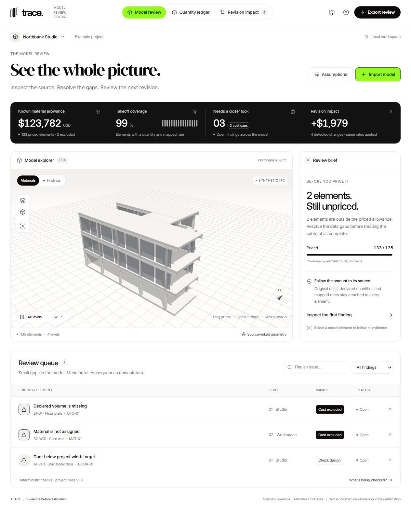
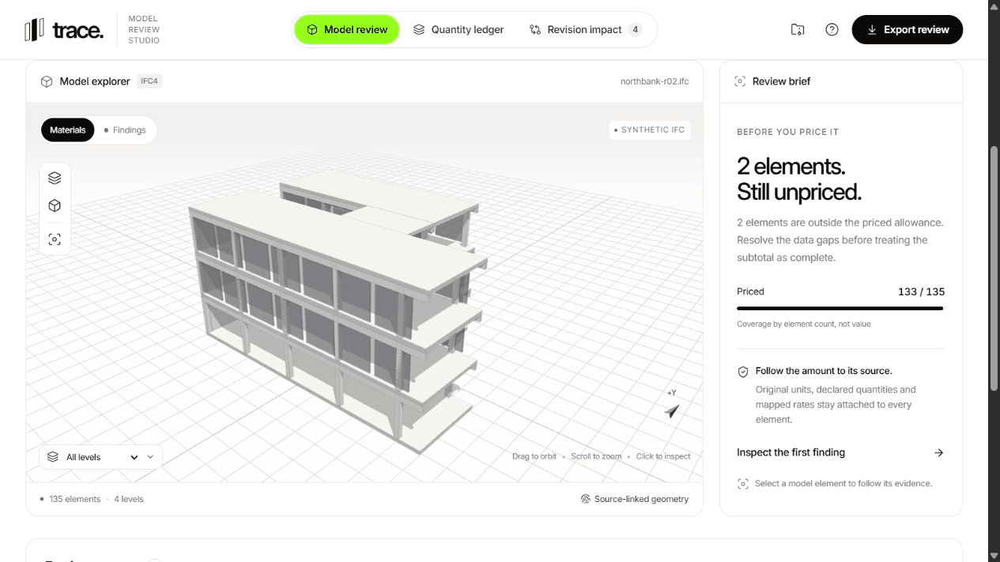
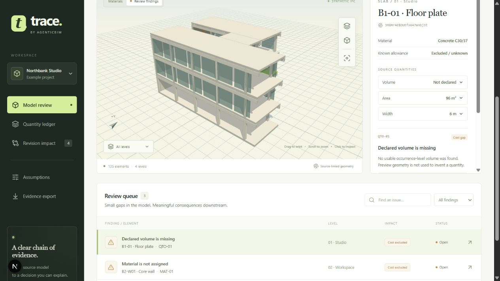
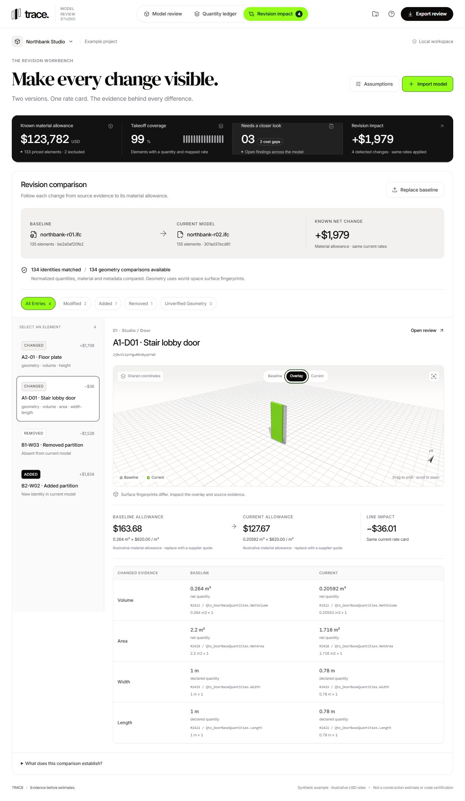

# Trace · AgenticBIM

**Review an IFC model before you price it.**

Trace is a local review workspace for quantity surveyors and BIM coordinators. It connects each element's 3D geometry to its declared quantities, material rate, review notes and revision history.

An incomplete model can still produce a convincing total. Trace keeps the missing pieces visible: an unquantified slab stays excluded, an ambiguous material stays unpriced, and an unknown revision impact never becomes a zero-dollar change.



[Quick start](#run-locally) · [Walkthrough](#walkthrough) · [Engineering decisions](docs/PRODUCT_REVIEW.md) · [Verification](docs/VERIFICATION.md)

## Walkthrough

The sequence below was captured from the running app: model → separated floors → missing quantity → revision overlay → baseline/current → source calculations. It is a sequence of actual screens with reading pauses. The building is a clearly labelled synthetic IFC example.



Try the same review in the included Northbank Studio project:

1. Open **Model review** and separate the floors using the layer control.
2. Select **Declared volume is missing**. The slab remains visible in 3D, but its allowance is excluded. Preview geometry does not invent a quantity.
3. Open **Revision impact** and select **A1-D01 · Stair lobby door**. Compare the baseline and current geometry, then inspect the declared width: **1 m → 0.78 m**.
4. Follow its material allowance: **0.264 m³ × $620/m³ = $163.68**, changing to **0.20592 m³ × $620/m³ = $127.67**. The line impact is **−$36.01**, using the same rate for both versions.
5. Change a rate under **Assumptions**, then export the **CSV schedule** or **JSON evidence record** to inspect the calculations outside the app.

The example contains 135 elements, two excluded items, three findings and four revision changes. Both source files are included: [baseline IFC](frontend/public/demo/northbank-r01.ifc) and [current IFC](frontend/public/demo/northbank-r02.ifc).

<details>
<summary>Still images: source evidence and revision workbench</summary>





</details>

## Run locally

With Docker and Compose v2, start the complete production stack from the repository root:

```sh
docker compose up --build -d --wait
```

Open [localhost:3000](http://localhost:3000). See [deployment and import budgets](docs/DEPLOYMENT.md) for operation, smoke checks and hosting boundaries. The setup below is for development without Docker.

Requires **Node.js 22+** and **Python 3.12**. The bundled example works with the frontend alone; importing your own IFC also needs the Python service. No API key or external inference service is needed.

### Frontend

```sh
cd frontend
npm ci
npm run dev
```

Open [localhost:3000](http://localhost:3000).

### IFC import service

In a second terminal, from the repository root:

**Windows / PowerShell**

```powershell
py -3.12 -m venv .venv
.venv\Scripts\python -m pip install -r backend/requirements-dev.txt
cd backend
..\.venv\Scripts\python -m uvicorn main:app --host 127.0.0.1 --port 8000
```

**macOS / Linux**

```sh
python3.12 -m venv .venv
.venv/bin/python -m pip install -r backend/requirements-dev.txt
cd backend
../.venv/bin/python -m uvicorn main:app --host 127.0.0.1 --port 8000
```

The frontend proxies `/api/ifc` to this local service. For a different address, copy [`frontend/.env.example`](frontend/.env.example) to `frontend/.env.local`, set `IFC_API_URL`, and restart Next.js.

Use **Import model** for the current IFC and **Revision impact → Add baseline** for an earlier export of the same project. A successful current-model import replaces the local workspace and clears the baseline. Failed imports preserve the existing review.

Uploads are limited to **25 MB and 5,000 physical elements**. Temporary IFC files are deleted after parsing. Review state stays in IndexedDB on the current browser/device; clearing browser data removes it. JSON exports are evidence records, not importable workspace backups.

Each import runs in a disposable parser process with a 60-second server deadline. One import is admitted at a time by default; excess requests receive a retry response. Upload bodies have a separate size and time budget. Disconnecting stops the worker. Linux deployments also enforce worker CPU and address-space limits.

## What the workspace does

| Task | Behavior |
| --- | --- |
| Navigate a model | Source geometry, orbit and zoom, element selection, level filters, X-ray and animated floor separation |
| Inspect a quantity | Original value and unit, conversion factor, STEP quantity path, normalized value and net/gross basis |
| Build a material allowance | Exact material-to-rate mapping, rounded line amounts and explicit exclusions |
| Review a finding | Project width checks, missing material/quantity checks and notes tied to the current assumptions |
| Compare revisions | GlobalId matching, shared-coordinate overlays, removed-element inspection and before/after quantity evidence |
| Inspect comparison gaps | An explicit queue for missing or incompatible geometry fingerprints |
| Hand off evidence | CSV quantity schedule and versioned JSON containing sources, assumptions, findings, decisions and comparison coverage |

Changing a model or rate invalidates active acknowledgements from the previous review context. Acknowledging a finding never changes its source data or makes an excluded item priced.

## Engineering

```text
IFC file → bounded upload → isolated IfcOpenShell worker → ModelSnapshot v1.0
                                         ↓
Bundled IFC snapshot ───────────→ deterministic evaluator
                                         ↓
                              3D view ↔ source inspector
                                         ↓
                              local review / JSON / CSV
```

- [`backend/ifc_parser.py`](backend/ifc_parser.py) extracts occurrence-level quantities and their unit provenance. It rejects duplicate identities and ambiguous quantities.
- [`backend/parser_process.py`](backend/parser_process.py) supervises parsing; [`backend/import_guard.py`](backend/import_guard.py) bounds requests before multipart allocation.
- [`backend/tessellation.py`](backend/tessellation.py) handles convex planar meshes, mapped instances and straight rectangular/convex-profile extrusions. More complex bodies go to IfcOpenShell's native geometry module. Unsupported shapes keep their ledger records and visible warnings.
- [`frontend/lib/model.ts`](frontend/lib/model.ts) owns pricing, findings and revision comparison. The demo and real imports use this same evaluator.
- [`frontend/components/model-viewer.tsx`](frontend/components/model-viewer.tsx) renders on changes and while interaction settles, then stops requesting frames. It disposes scene resources and respects reduced motion.
- [`frontend/lib/render-geometry.ts`](frontend/lib/render-geometry.ts) recenters survey coordinates before GPU conversion; revision meshes share the same origin so displacement is preserved.

### Limits that matter

Declared IFC quantities are **source declarations, not independently measured geometry**. Rates are illustrative USD material allowances, excluding labour, installation, waste and tax. Door checks use declared overall width against a project target; they do not establish clear opening width or code compliance.

Revision comparison requires stable GlobalIds and shared model coordinates. Fingerprints ignore vertex numbering, triangle order and winding on a 1 µm grid; different triangulation can still register a difference. Missing or older fingerprints are unverified and require re-importing both models for geometry comparison.

This is a working local prototype with a packaged local deployment. There is no hosted collaboration, authentication, IDS import, BCF export or clash detection. Linux integration tests cover native curved profiles, mapped instances and opening subtraction; larger customer models and public hosting still need validation. The [engineering assessment](docs/PRODUCT_REVIEW.md) explains the scope and tradeoffs.

## Development and checks

```sh
cd frontend
npm test
npm run lint
npm run build
```

```powershell
cd backend
..\.venv\Scripts\python -m pytest -q
```

On macOS/Linux, use `../.venv/bin/python` for the backend check. The suite currently has **13 frontend and 34 backend tests**, including two Linux-native integration checks. [GitHub Actions](https://github.com/SanishKumar/AgenticBIM/actions/workflows/checks.yml) runs both suites, lint, the production build, a production dependency audit and the complete container smoke check. The [verification record](docs/VERIFICATION.md) documents browser checks and coverage limits.

The production build uses webpack for consistent Windows behavior. To serve it locally, run `npm run build` followed by `npm start` in `frontend`.

Regenerate the two synthetic IFC files and parsed snapshots from the repository root:

```powershell
.venv\Scripts\python backend/generate_demo.py
```

The generator preserves element identities across revisions and includes deliberately missing data. [Media notes](docs/MEDIA.md) describe the README captures.
