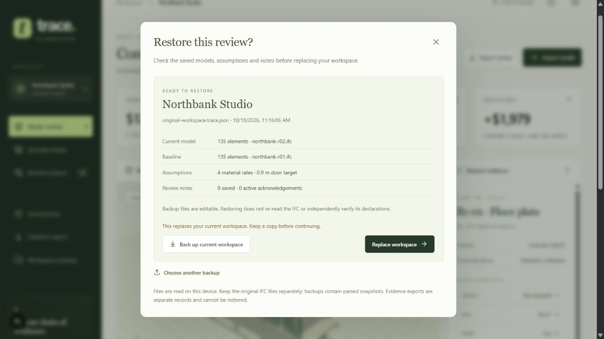

# Workspace backup and recovery

The browser saves the active review in IndexedDB. A downloaded backup gives you a separate copy that can be reopened after browser data is cleared or on another device running Trace.

1. Open **Workspace backups → Download workspace backup**.
2. Keep the `.trace.json` file with your project records.
3. To reopen it, choose **Workspace backups → Choose backup**.
4. Check the project, current model, baseline, assumptions and note counts in the preview.
5. Back up the current workspace if needed, then select **Replace workspace**.

## What is retained

The versioned `trace-workspace/1.0` document contains an export timestamp and a workspace: current snapshot, optional baseline, material rates, door-width target, review notes and their original context. Geometry is included. Original IFC bytes are not; keep the source files separately. Transient view settings such as the camera and search are reset on restore.

Notes keep their original model/rate context. A note that was inactive when the backup was made does not become an active acknowledgement on restore. The preview counts only acknowledgements matching both the current context and a current finding.

Evidence JSON (`trace-review/1.0`) omits mesh arrays and serves as a handoff record. It cannot be restored as a workspace. CSV is the full-model quantity schedule, even when the ledger shows a search result or a single page.

## Validation and failure behavior

Backups are limited to 128 MiB. Each model supports up to 5,000 elements and 750,000 preview triangles; aggregate vertex coordinates are also bounded. The validator checks snapshot versions, required fields, duplicate identities, finite values, triangle indices, quantity dimensions and conversion consistency, rate mappings, note timestamps and text lengths. Assumptions support up to 1,000 rates; individual text fields and notes are limited to 16,000 characters. These are structural and numerical checks, not independent verification of the IFC source.

A malformed or unsupported file never reaches the replacement step. Restore writes a single IndexedDB transaction before changing the visible workspace, and waits for earlier queued saves. If storage fails, the current review remains in place and the dialog reports the failure. If existing browser data cannot be read or validated at startup, automatic saving is suspended so the example cannot overwrite it; the UI shows a storage warning.

Backup files are editable and unsigned. Restoring does not re-parse the IFC, authenticate the author, verify stored fingerprints against source bytes, merge projects or reconcile simultaneous browser tabs. Keep a backup before switching projects; use one active review tab per browser origin. Browser storage and available memory still limit practical model size.
